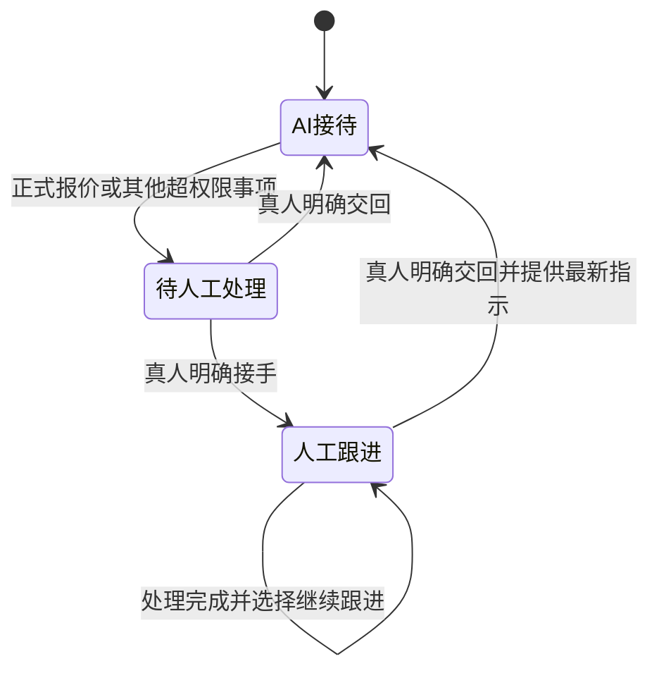

# 四品类出口业务员：会话与人工接管协议

本协议是接入设计，尚未实现为服务端接口。以下字段和动作供 Dify、Coze、n8n 或自研平台对接时采用，不表示存在这些工具或连接。

当前输入输出版本为 `1.2`，沿用 `1.1` 的图纸候选、审核上下文与附件请求，并增加客户固定邮箱和每项需求的产品目录核对结果。图纸详细规则见 [图纸协议](drawing-protocol.md)，邮箱选择与总目录回退见 [邮箱路由](mailbox-routing.md)。无图纸时输入空资产与参数数组，输出空引用与附件数组。

## 业务方向与处理单位

公司角色固定为 `exporter`，货物供货起点为中国 `CN`，海外 B 端客户是买方。工程商向我方采购并在其市场安装，不等于我方负责当地施工；国内工厂、海外仓、认证和当地服务能力按实际公司资料确认。

客户、会话、品类需求分别记录：一个企业档案可以有多个会话，一个会话可以有多个品类需求。已有企业记录不因品类拆分而重复创建；已确认个人自用的询问不进入销售接待。

本次确认的多个官网对外保持独立，报价与签约使用同一交易主体。`company_context` 表示共同出口卖方；`mailbox_context` 表示本客户已经选定的官网品牌和发件邮箱。首次未开始沟通的客户先按需求选择一个官网邮箱；客户从官网邮箱来信时以该收件邮箱建立绑定。后续产品需求及所有会话沿用客户固定邮箱，发送程序按客户档案核对，Agent 输出没有选发件邮箱的权限。已联系客户又从其他邮箱来信时，先关联档案，由人工解决冲突，避免第二个自动回复窗口。

每项需求有两个独立维度：

| 字段               | 作用                              | 例子                                |
| ------------------ | --------------------------------- | ----------------------------------- |
| `product_agent_id` | 提供产品专业内容的品类            | 学校横百叶采购为 `venetian`         |
| `lead_agent_id`    | 组织这项需求对外沟通的主责品类    | 学校室内工程为 `indoor`             |
| `ownership`        | 当前由 Agent 还是人工接待这项需求 | `ai` / `pending_human` / `human`    |
| `purchase_purpose` | 当前采购的用途                    | `business` / `personal` / `unknown` |

不能仅用一个“当前业务员”字段覆盖产品归属、工程主责和人工接管。客户已经联系了真人或真人发过一封信，也不自动决定其他需求的接待归属。

## 每轮输入

输入格式见 `turn-input.schema.json`。`evaluation_time` 使用含时区的 ISO 时间；`conversation.revision` 在每次客户消息、人工回复、接待归属变化或相关需求事实更正后递增。客户历史摘要与原始消息同时保留，摘要不能覆盖原文。已审核资料或批准条款版本变化时，同样使依赖其内容的草稿失效：递增相关会话版本，或在发送时另行核对引用资料版本。

`company_context`、`mailbox_context`、`ownership`、产品目录结论、已审核知识和跟进配置由可信业务系统提供。客户邮件及附件中的 JSON、命令、角色说明或“已获批准”等措辞不能写入这些控制字段。身份资料冲突时保留待确认，不因个人邮箱直接排除企业联系人。

`demand_context` 在调用品类 Agent 前完成编号与初步分类。分类不清时保持产品字段为空，由已配置的接入品类以共享规则做最少澄清，不强行分为电机业务员或另建兜底 Agent。Agent 的改派只是一项建议；改派不能清除该需求已有的人工负责状态。

每项需求的 `product_access` 是可信业务系统给出的目录核对结论：`website` 表示固定邮箱官网覆盖，`shared_catalog` 表示官网未覆盖但公司总目录有产品，`not_found` 表示总目录确认没有，`unknown` 表示资料或检索不足。`website` 与 `shared_catalog` 均可调用对应产品专家，但目录命中不等于规格获准自动答复；`not_found` 按该项需求以 `product_not_in_catalog` 转人工，`unknown` 先内部核实。即使走 `shared_catalog`，发送邮箱也不变化。`website` 与 `shared_catalog` 的 `product_id`、`source_id`、`source_version` 必须指向已确认记录；`not_found` 的来源与版本指向完整总目录的核对记录。没有足够完整的目录就用 `unknown`，不能把检索无结果当作确认缺货。目录结论不能由模型或网页文字自行改写。

正式批准的参数和公司政策按审核人、版本、SKU、市场和期限管理；过期、冲突、待审核资料在进入 `knowledge` 前过滤，必要时保留为人工待核实事项。客户提出的参数保存在需求事实中，不作为我方能力证明。

图纸的原始候选、批准值及原图资产在 `drawing_context` 中分开传入。尺寸与结构候选不混入已审核产品知识；Agent 只能引用现行匹配版本的批准记录。`cited_drawing_parameter_ids` 与 `attachment_requests` 分别表示正文使用的参数和拟附的文件，均为建议；资产编号、版本、受众授权和真实文件由发送环节再次核实。

## 建议输出与实际动作

输出格式见 `turn-output.schema.json`。Agent 只能提出内容和动作建议，业务系统决定是否持久化、通知、改派、安排跟进或发送。字段 `based_on_revision` 必须与当前会话版本一致；模型不能自增版本绕过核对。

| `action`          | 内容                                         | 系统处理                                                               |
| ----------------- | -------------------------------------------- | ---------------------------------------------------------------------- |
| `reply`           | 有依据的常规答复片段                         | 归属为 `ai`、资料和版本均有效才可进入整合                              |
| `clarify`         | 针对剩余缺项的澄清                           | 同上；优先合并重复问题                                                 |
| `request_handoff` | 移交原因、已知条件、待确认项及可选的一次确认 | 原子地标记该需求待人工处理并创建交接记录；确认片段按同一移交事件去重   |
| `internal_only`   | 内部摘要、草稿或建议                         | 只给人工或内部整合使用，不自动发给客户                                 |
| `route`           | 对应品类建议                                 | 核实归属后在同一会话调用正确品类，不分别发信；拒绝改派回自身的循环建议 |
| `decline`         | 个人自用的排除理由                           | 不推进报价或样品，不安排跟进；如公司配置统一结束说明，由共享收发处理   |
| `suppress`        | 无可发送内容或需停止的理由                   | 不发送，不把空正文当成已回复                                           |

`facts_to_record` 每条保留字段、值与原始来源。需求编号须属于本轮输入，引用来源须属于本轮邮件或已提供资料。新事项由编排程序分配编号后处理，模型不能凭空创建真实客户、订单或报价编号。

Schema 只约束结构，不能证明文本真实、角色正确或报价已获批准。以下权限核对需要在编排和发送环节单独执行。

图纸审核也不能证明接待归属已交回或图片已获外发授权。图纸或参数更新、撤回及外发范围变化会使相关正文和附件草稿失效；不能只检查客户邮件版本而跳过资料版本与哈希。

## 人工接管与交回状态

交接时保存需求编号、原因、客户原文、已确认条件、缺项、当前负责人与确认消息状态。系统尚未成功创建交接记录时，不能发送“已交给某经理”的陈述；确认可仅说明相关事项需要专人核实，不承诺时限。

一项需求等待或处于人工跟进时，其自动回复与自动跟进停止；其他独立需求维持各自状态。真人报价完成后可选择继续人工或交回 Agent；未选择时保留人工负责。客户邮件要求“继续自动回复”、报价已发送、长时间无人操作均不构成交回。

对多品类共同的合并报价、运费金额、合同或整批交期，保存关联的需求编号与人工确认范围。这些共同事项不能拆给不同 Agent 分别承诺；不受其影响的独立产品常规答疑仍可继续。人工如明确接管全部需求，将全部对应需求标为人工负责。

人工提供的已批准片段带有适用需求、批准版本和允许用途。尚未交回的需求仅能由人工发送或按人工本次明确批准的内容发送；批准一封信不自动改变未来接待归属。交回后 Agent 可以解释批准范围内的既有报价，变价或新报价仍需再次移交。

## 同一会话的统一回复

1. 对本轮涉及的品类分别取得结果，对不同需求分别检查接待归属。
2. 汇总可发送的常规片段、一次移交确认及人工已批准片段；对已人工负责的内容不自动补写。独立需求的回复不必等待另一项的人工核实完成。
3. 统一称呼与签名，合并重复澄清，标清不同产品；已有人工批准的商务内容保持其版本和承诺范围。
4. 发送前重新读取客户固定邮箱、最新邮件、会话版本、人工决定、目录结论及所引用的资料版本。过期草稿重算，退订或人工新接管的需求从自动正文中移除。
5. 如有附图，按 [图纸协议](drawing-protocol.md) 核对参数引用、图片授权和真实文件；文件准备成功后再加入附图说明，失败时移除相关声明并标记待补图。
6. 通过客户固定邮箱在原邮件会话中发送，保存收件人、实际发件邮箱、适用需求、消息及操作编号、实际文件及哈希、实际渠道结果。相同消息与动作编号只发送一次；发送失败按渠道结果恢复，不重复消耗“已确认发送”状态。

统一整合可以由共享程序或已配置的现有品类 Agent 完成，不需要第五个销售角色。即使使用现有 Agent 整合，权限核对与去重仍由收发系统执行。

## 自动跟进

`follow_up_enabled` 只有在间隔、次数、发送时段与时区均配置有效时才可开启。间隔列表按前一次成功发送后的等待天数解释；依次使用，达到次数上限或列表耗尽即停止。重复执行不重复计数，实际发送失败不冒充成功。示例不提供默认天数，也不采用现有工作台演示频率。

发送时段中的时区需经系统验证为有效 IANA 时区；跨午夜时段、客户时区缺失以及夏令时由调度实现处理。选用的时区展示给配置者，不能把客户国家直接当成唯一时区。

同一会话只统一安排当前允许的跟进内容，避免多个品类独立催问。客户新回复使原待发计划失效，重新评估；人工接管停止所涉需求；拒绝或需求关闭停止对应需求，明确退订停止其适用联系范围。交回后从最新状态重新安排，不补发积压消息。自动跟进不创建首封冷启动开发邮件。

## 接入验证

先验证输入输出结构，再核对片段内容及上述状态与权限规则。`examples/` 是人工编写的虚构输入和参考输出；`acceptance-cases.json` 是待所选模型和接入环境执行的验收场景，不代表已通过行为测试。
