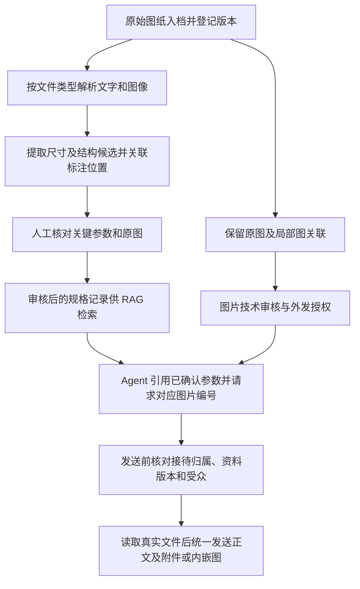

# 图纸尺寸提取、原图关联、审核与回复附图

本规则适用于四个中国出口卖方 Agent，用于向海外 B 端买方提供有依据的产品信息。当前交付是规则与数据协议；OCR、视觉模型、CAD 解析器、人工审核界面、文件存储和邮箱发送尚未接通，也未处理真实产品图纸。

## 处理链路



文字检索使用审核后的结构化规格与必要说明，原图保存在文件库，通过资产编号关联。支持多模态检索时也可检索图像；这不取消关键参数审核和发送前核验。可以先按 SKU、部件和图号版本精确筛选，再检索相关说明，避免只按一个尺寸数字匹配。

## 提取候选与原始依据

原生 PDF 可先提取文字与布局；扫描 PDF、PNG、JPG 需 OCR 或视觉解析。DWG、DXF 等原生 CAD 需对应解析器，或导出清晰 PDF / 图片再处理；文字模型不能直接假定掌握 CAD 对象关系。

自动提取内容统一先标为待审核，包括尺寸名称、数值、单位、公差、孔位、视图和明确标注的结构说明。保留原文和提取方式：原生文字、OCR、视觉、CAD 或人工录入。自动评分高、OCR 可识别或来自 CAD，都不能代替人工批准。

一条参数必须能回答“哪个产品、哪个部件、哪张图的哪个版本、哪一页哪个视图、哪条标注”。分块时保留数值与尺寸名称、单位、公差、图号及相关总说明的关系。无法确定尺寸线指向、内外径、多个相邻零件归属或多视图对应时，记录疑点，交人工核实。

不从图像像素比例、透视图或外观估算制造尺寸，不把未给公差理解为零公差，不静默换算单位。CAD 的实际测量、显示标注、手工覆盖文字及图纸单位不一致时，保存差异并核实，不自行选择其中一个。阅读结构关系不等于完成强度、风载、装配、品牌替代或可制造性校核。

## 原图与参数的关联

数据结构见 `drawing-context.schema.json`，通过输入的 `drawing_context` 提供：

| 记录         | 关键字段                                                                           | 约束                                                   |
| ------------ | ---------------------------------------------------------------------------------- | ------------------------------------------------------ |
| 图纸资产     | `asset_id`、`drawing_id`、`drawing_revision`、`product_skus`、文件名和内部存储引用 | 资产编号绑定具体文件版本；多 SKU 共用图需逐一明确关联  |
| 文件完整性   | `content_hash`、`document_status`                                                  | 哈希由真实文件计算；现行、被替代、撤回分别记录         |
| 来源与派生   | `origin`、页码、视图、`parent_asset_id`                                            | 公司规格与客户要求区分；局部图能回到原图               |
| 提取候选     | `raw_text`、`extracted_value`、单位、公差、提取方式与疑点                          | 不覆盖原始标注，不作为已确认供货参数                   |
| 人工批准参数 | `parameter_id`、`approved_value`、单位、公差、审核人、时间及意见                   | 批准值与候选值分开，定位到该版本图纸上的标注           |
| 图片技术审核 | `technical_review`                                                                 | 核对图面及所保留上下文，批准引用一条数值不等于批准整图 |
| 图片外发授权 | `external_release`                                                                 | 明确是否可外发、全部 B 端或指定客户范围及批准记录      |

`source_region.bbox` 按归一化的 `[左, 上, 右, 下]` 记录，范围为 0 到 1，且左小于右、上小于下。它只用于定位原图区域，不能换算产品实际尺寸。单张图片按第 1 页记录；无法提取框坐标时，人工至少确认页码和可定位的标注说明。

客户发来的图纸可用于提取其采购要求。即使人工确认“客户标注为 38 mm”，也不能据此回答“我方现货就是 38 mm”或承诺能制造、能兼容。客户资料只允许在该客户已授权的范围使用，不能进入对其他客户的通用外发图库。

## 关键参数人工审核

审核人对照源文件核对 SKU、部件、视图、尺寸名称、原始单位、小数点、直径及角度符号、公差和必要总说明，选择通过、拒绝或继续待核实。修正候选值时填写批准值与原因，保留原候选和原文。

参数 `review_status: approved` 需要审核人、审核时间、批准值及可回查位置；尺寸参数还需明确单位。只有此状态且源资产仍为现行匹配版本，Agent 才可将批准值用于对外答复。待审、拒绝或被替代的参数只供内部核实。无图纸的普通产品知识仍按原有已审核知识规则使用，不能用笼统 RAG 段落绕过图纸参数审核。

这里的参数批准包含允许用于适用受众的自动文字答疑；仅做完技术核对但仍为人工专用的资料不以该状态提供给 Agent。客户来源参数的引用受众取源资产的指定 `customer_ids`，当前客户不明确或不在名单中时，文字数值同样不能自动外发；名单不明确时保留为内部材料。图片外发本身还需额外通过图片技术与外发状态核验。

参数批准、图片技术批准、外发批准与接待权交回是不同动作。正式报价仍由人工处理；审核图纸或确认报价后，人工可继续接待，也可明确交回 Agent。Agent 不能因为参数获批就自行改变 `ownership`。

局部图需要单独核对其内容和外发范围，保留必要单位、公差、标题及视图关系。原图批准不自动放宽派生图权限，也不能把丢失关键上下文的裁切图当作完整依据。确需脱敏或改图时由人工批准新资产版本，不生成一张看似正确的新技术图代替源图。

## 回复引用与附件申请

图纸字段自单轮协议 `1.1` 引入，现行会话协议为 `contract_version: 1.2`。无图纸的输入也提供空的 `drawing_context: {"assets": [], "parameters": []}`；无图纸引用或无附件的输出分别提供空数组。

每项可自动回复的需求使用以下字段：

```json
{
  "cited_drawing_parameter_ids": ["DEMO-PARAM-OUTER-DIAMETER-B"],
  "attachment_requests": [
    {
      "asset_id": "DEMO-ASSET-TUBE-B",
      "drawing_revision": "B",
      "parameter_ids": ["DEMO-PARAM-OUTER-DIAMETER-B"],
      "delivery": "attachment",
      "caption": "DEMO-DWG-TUBE, Rev. B — tube section"
    }
  ]
}
```

这只是虚构格式示例。Agent 不输出任意本地路径、外部图片 URL 或文件正文。`parameter_ids` 必须属于该图纸资产，并包含在本项实际引用的批准参数中；未引用参数的合格产品说明图可使用空数组。参数编号也列入 `source_ids` 以便回查。

`reply` 和 `clarify` 才可申请自动附图；`internal_only`、`route`、`decline`、`suppress` 及一次移交确认 `request_handoff` 的附件申请和对外图纸引用均为空。人工负责事项可形成内部建议，但附件由人工在其发送或明确批准单封回复时选择，不通过空接待权的自动路径外发。

正文可以直接说明已批准的尺寸并引用图号版本；发送程序在真实附件准备成功后加入“请见附件”或内嵌图片描述。Agent 的申请不代表文件已找到、已上传、已发送或客户已收到。

## 发送前逐项核验

结构 Schema 只检查字段形状，以下关联和权限需要编排程序单独执行：

1. 当前客户是适用 B 端，需求仍允许 Agent 自动接待，或该次人工发送已明确批准；拒绝、退订和关闭状态仍按原会话规则处理。
2. 参数编号、资产编号来自本轮可信记录，无重复编号或悬空引用。批准参数与源图 SKU、部件、页码及版本相符；附件相关参数必须确实出现在其关联原图或局部视图中。
3. 图纸及批准参数为现行版本，审核记录完整且允许自动答疑；客户来源参数只向其源资产指定客户范围引用。待审候选不能用于正文、图片标题或附件描述中的技术承诺。
4. 图片技术审核和外发授权均批准；当前客户满足外发受众范围。客户来源图片不得使用 `all_b2b` 授权，指定客户列表需明确覆盖实际收件客户；附有其他收件人时逐一核对。
5. 按资产登记的内部引用读取真实文件，核对内容哈希、实际 MIME、文件大小及渠道限制。正文内嵌仅用于渠道支持的图像类型，其他已授权文件作为附件或交人工处理，不伪装格式。
6. 合并多个品类的附件申请并去重，保留各参数与文件的引用关系。不能用相近型号、旧版图纸或未审核的替代图补足附件。
7. 再次核对最新会话版本、人工决定与资料版本；成功后在同一邮件会话统一发送，记录实际文件、哈希、批准范围与渠道结果，重复触发不重复发送。

文件读取失败、权限不足、版本冲突或图片不可用时，撤除“已附”声明和失效引用，不记录为已发送附件。可独立核实的文字答复仍可保留；客户明确要求但暂无法提供的图纸标记待补，交人工处理对应需求，不阻断其他独立常规需求。

## 修订与失效

源文件内容、图纸版本、SKU 映射、批准值或外发范围变化时，保留旧记录并使关联草稿、待发附件和检索缓存失效。新文件采用新的资产编号和内容哈希，旧参数批准不自动继承；确认无变化的参数也要明确关联并审核到新版本。以最新文件覆盖同名路径不能绕过版本与哈希核对。

`examples/drawing-input.json` 与 `examples/drawing-output.json` 为虚构的已审核规格和附图申请演示，文件引用和哈希不代表真实文件存在。E27–E40 覆盖读图、审核、原图关联和发送异常，均需在实际接入后执行；本设计不声称图纸识别或邮件发图已经实测通过。
