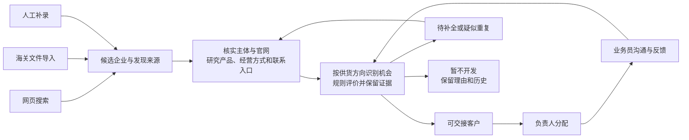

# 获客系统首期成品方案

状态：产品行为与简化两表方案已由用户确认，开始分步实施。官网自动评分和T12历史链路优先接入，其他首期项目按下述范围继续实施。2026-10-21整理。

范围汇总：[首期范围、评分与飞书字段](acquisition-final-review.md)。海关15分方案用户已认可；本次按最新云服务器部署方向收束。T2简化、T12建表及官网自动评分/历史同步已实施，其他业务改造分步开展。

## 产品目标

为公司内部销售团队持续准备值得沟通的外贸企业客户。负责人预先设置供货方向、目标市场、客户画像、每轮新增目标和定时安排，系统完成发现、研究、去重、供货机会评价及联系方式整理，负责人分配后，业务员以客户沟通为主要工作。

第一批完成网页搜索、官网研究、海关文件导入、人工补录的真实闭环。地图、黄页、独立社媒采集、Lookalike、海关API和自动触达按后续里程碑接入。

## 一条完整流程

“客户”按企业统一建档；同一企业可有多个联系人、来源及供货机会。系统需要知道可能卖给它什么、依据是什么、有什么联系入口以及还缺什么资料。

## 网页如何使用

| 入口 | 负责人日常操作 | 关键展示 |
| --- | --- | --- |
| 获客计划 | 新建、定时、立即运行、修改未来安排、暂停/恢复计划 | 目标国家/区域、供货方向/产品族、目标画像、来源、每轮新增数、时间、运行上限 |
| 执行记录 | 看本轮进度、暂停/继续、结束、查看历史和未达标原因 | 候选数、研究数、新增可交接企业数、更新数、排除/待补数、失败及资源消耗 |
| 客户库 | 查看全部或本人客户、筛选、分配/转交、人工补录、海关导入、导出 | 企业身份、最高可开发机会及对应方向、分数/等级、准备情况、负责人和跟进状态 |
| 待处理 | 核实疑似重复、关键事实冲突、缺资料、写入待核对及同步失败 | 每项说明问题、已有证据、建议操作和处理历史 |

设置提供供货方向、目标画像、评分版本、API连接及账号权限。海关导入是客户库和发现来源的一个入口；官网研究是多入口共享的处理步骤。

首期工作台仅汇总真实获客数据。现有未接入的沟通/经营演示从正式导航移出，业务员不会看到虚构漏斗或回复率作为真实经营结果。

客户详情显示企业事实、各供货机会、计分明细、来源原文/贸易记录定位、联系入口、可公开取得的采购岗位人员、未知与障碍、已有沟通和分配历史。没有沟通历史时显示尚未联系，不要求先有历史才能交接。

## 负责人和业务员

- 管理/负责人账号配置计划、查看全库、分配和转交、处理异常、审核合并及发布评分规则。
- 业务员使用个人账号查看和处理自己负责的客户，更新手工跟进状态、备注和客户质量反馈。跨客户查看及管理权限由角色限制。
- 同一企业同一时间只有一名主责业务员；多个供货机会不形成多份重复客户分配。转交保留前任责任人和记录。
- 技术维护所用平台密钥只在服务端，普通业务员界面不显示密钥或调试日志。
- 第一版网页统一修改业务状态；飞书同步用于查看协作。飞书直接修改字段是否回流不是首期默认行为，避免两端各改成不同状态。

## 供货方向与画像

窗饰成品、材料配件、样本册/展示资料分别配置目标画像。方向可以细分室内/室外及产品族，不能把“属于窗饰行业”直接当作目标产品匹配。

目标画像记录希望找到的经营角色、产品业务、规模线索和排除条件；企业画像记录实际查到的事实。工厂、零售、本地服务或面向家庭消费者，都不单独决定是否能采购我方产品。

首次计划可使用现有支持市场；首批海关验收使用已取得的美国样本。超出现有国家范围时明确增加数据和查询能力，不把搜索目标当作企业真实所在地。

## 发现来源

### 网页与官网

现有网页搜索和官网补全链路继续使用。任务内允许按已确认方向扩展同义词、当地用词及组合；保留搜索词、地区、来源、时间和产出。

原文证据不足时留未知。官网产品目录代表其经营产品；企业自己明确表达的求购、询价或寻找供应商另存公开采购需求。资料中的指令不改变任务或系统规则。

随官网研究查看Contact、About、Team或供应商合作页面。有明确采购岗位则附公开姓名、原始职位和来源；没有则使用公司级入口。规格、预算、采购周期和决策权不凭空补齐。

### 海关文件

按用户要求，首期提供网页CSV/XLSX导入入口及相应上传、预览、确认、任务进度与结果接口，支持部署到云服务器后的日常导入。具体字段、云端后台处理、大文件分批/续传、权限、重复导入和评分前提见 [海关网页导入方案](customs-import-spec.md)。这是实施要求，当前尚未实现。

校验文件、字段、查询国家/时间/关键词和记录数，保存导入批次与原始来源。先提取候选收货企业，再核实采购主体和官网，不能把通知方、承运人和发货方全部当目标买家。

同一文件重复导入可识别，不新增重复批次/客户；不同批次中相似贸易行保留出处，缺少唯一提单/明细标识时不宣称已经精确合并成独立采购。

现有样本没有金额、重量单位和唯一提单号，部分描述截断。可用于候选发现与已匹配的相关进口活动线索，不能按行数、总重量或混装箱量估算利润、采购次数或卷帘件数。

从供应商反向找买家时只描述数据覆盖内发现的交易对象，不承诺其全部客户；第一版先完成表中可见双方的关联与核实，API链式扩展后续接入。

### 人工补录

可以提交公司名称/官网和已知资料，注明人工来源。系统执行同一套主体核实、去重、研究和评价；已具备资料可以作为有来源的人工事实，仍保留录入人及时间。

## 计数、运行和更新

- 每轮目标是新增、去重后符合交接条件的企业数，不是网页、原始记录、候选或更新次数。一企业多机会仍只算一家。
- 新候选先建档不计目标，第一次达到可交接条件时才计为新增可交接企业，不要求候选一定在同一轮创建。历史已交接企业及迁入的存量客户再次补全/刷新另计更新量，不能反复占用新增名额。
- 负责人可设置目标量；管理员配置处理容量和搜索/研究/运行时长上限。默认额度基于现有安全上限和首批真实消耗测量，不为保证凑足数量无限调用，也不降低准入质量。
- 达到上限或找不到更多候选时部分完成，保留结果、缺口和原因。负责人可追加运行额度/时长继续补找，原计数和历史保留。
- 普通暂停让当前企业处理到可保存状态后停下，恢复继续剩余工作；结束本轮是独立操作。
- 写入结果未知先核对，不当失败直接重复新增；对不确定企业保留待核对状态。普通暂停与写入待核对在界面区分。
- 同一计划未完成时不堆积新一轮；错过多个时间点只补最近一轮，其他记录未执行原因。不同计划默认按到期时间排队、受全局容量限制，此项为本次实施建议。
- 近期研究可复用，过期或新证据再研究；进口新记录持续关联原档案。首次建议研究复用30天，可配置；不同来源的事件日期和读取时间分别记录。
- 不把整个区域标成已完整扫描。相同查询在同轮不重复提交；已发现企业及搜索进度可复用，不因换词重复计新客。

首次就绪由真正完成准备的执行领取一次计数归因，企业级原子记录防止两个执行重复计数；候选创建时间和创建来源仍保留。迁入的既有客户带存量标记，资料补全不计新客。失败、重复发现或更新不重复领用新增名额。

## 去重和可撤销合并

同一来源企业ID、核实后的官网/名称/地址等组合形成身份依据。域名、邮箱、电话、相似名称均可作为线索，不能在有集团、分支或主体冲突时无条件自动合并。

明确同主体自动归档；不确定进入疑似重复，负责人选择合并或保留独立企业。合并记录原ID、来源、字段冲突、联系人、机会、责任人及历史，能够撤销；有分配冲突时由负责人确认。

重复发现用于补充资料和新供货机会，不直接丢弃。真实企业暂不开发时保留原因，某方向不匹配仅排除该方向。空白/测试记录清理先保留操作记录；有历史的客户不因低评级直接物理删除。

## 评价和销售交接

用户最新修正：不强求高利润。获客不设置高利润门槛，不因订单小或利润未知而排除；优先依据产品/经营角色契合、持续经营及实际采购信号。报价和合作条件后续商务确认。

采用 [评分v2](acquisition-scoring-v2.md)：P产品35、R采购角色25、D持续经营15、V供货能力需求10、I海关采购表现15。用户已认可I按规模5、频率/持续性6、新近性4的结构；单据/单位/覆盖不足时分项未知，具体数据口径和单位对应参数在海关导入实施时落成固定版本配置。扩张单列时机信号，真实规模、具体外采方式、利润未知独立展示。事实有证据，档位由程序按版本计算，AI不自由报分。含客户关系的校准明细保留本地。

用户已确认并要求优先接自动评分与T12，代码规则为acquisition-v2.1，无须等待领导另给权重。官网评分后更新T2并追加T12，校准中的海关满分假设与真实评价分开，不写回正式等级或参与分配/目标计数。之后有真实反馈再发布新版本，保存原评估历史。未知关键事实不自动评C；无海关/采购经理不直接淘汰。

交接需身份明确、至少一个无硬性障碍且满足门槛的A/B机会、一种有来源的公司级联系入口，以及机会理由、未知项和已有历史。具名采购人员是补充，普通电话不会自动标为WhatsApp。

总分高但入口缺失继续补全；已知规格冲突先核实。C和暂不开发默认不分配，负责人可在保留理由后重新评估或调整人工优先级。

## 数据和飞书

目标是让服务端持有可恢复的企业、机会、证据、评估、计划执行及责任人记录，网页统一操作，飞书同步业务摘要和必要历史。正式数据库和迁移方式在实施中确定，不能继续只靠飞书一行文本表示全部状态和关系。

用户已将飞书首期简化为T2客户主表与T12评估历史，不建独立供货机会表；拟供方向、匹配理由、分数解释、来源和缺项汇总到T2评级依据，网页/服务端保存必要结构。T2删除主体类型、最近接触时间改最近研究时间、客户类型改文本、客户等级改用户评级，新增开发状态及评级依据；T12建表已完成，原26条客户与未删除字段值保留。细节见 [简化字段方案](feishu-acquisition-simplified.md)。

首期网页任务汇总、每日汇总和待处理提醒真实可用；飞书只做表格，不发送主动消息。

## 开发顺序与验收

| 里程碑 | 交付 | 验收重点 |
| --- | --- | --- |
| 1 统一事实与档案 | 企业/机会/联系人/证据分开，现有数据迁移及真实客户详情 | ID与历史保持、来源语义清楚、不同方向不互相覆盖 |
| 2 评价与交接 | 规则v2、历史版本、准备状态、待分配队列 | 示例算分可复算；未知、适配障碍和联系缺失不被总分掩盖 |
| 3 三种发现入口 | 网页发现、海关文件、人工补录接同一处理链 | 文件重复导入不重建；同企业多来源不重复计数；真实事实和联系入口可追溯 |
| 4 自动运行闭环 | 分批、定时、运行上限、暂停继续、部分完成、最新一次补跑 | 重启可恢复、未知写入先核对、不无限追补、不为凑数收录 |
| 5 网页协作与飞书同步 | 个人登录、负责人分配/转交、业务员工作队列、异常处理、同步 | 权限正确、一企一主责、同步失败不伪装成功、用户能完成交接 |
| 6 云服务器部署 | 配置、备份恢复、运行维护、实际容量测量 | 保持自动运行、进程重启恢复、查询外部服务可达、扩大任务量有消耗依据 |

先用少量真实企业和现有Excel验收功能/证据/算分，再测批量吞吐和资源消耗；不以“任务返回成功”代替业务交接成功。业务结果若与v2预期偏差大，依据案例调整并发布版本。

## 需要公司提供或接入时确认的资料

- 产品供货方向、规格/材料、MOQ和无法承接的订单条件；没有的先留未知，不虚构。
- 首批负责人/业务员账号及职责，当前已有客户的归属和跟进记录。
- 服务器资源、外部服务可达性、备份位置及管理责任人。
- 海关服务覆盖、导出/API授权、费用及字段定义，需按实际数据供应商确认；导出字段要求见[海关导入方案](customs-import-spec.md)。

以上是接入资料，不再要求公司先替系统设计评分公式。最终以用户检查本方案后的确认作为实施依据。

## 对原参考需求的主要修订

| 参考表述 | 本方案 |
| --- | --- |
| 13个入口全部自动完成 | 已有网页链路、文件与人工入口先闭环，独立渠道按真实数据权限分期接入 |
| 邮箱相同丢弃、公司名相似直接合并 | 归档并保留新增证据；冲突待核实、合并可撤销 |
| 一个地区扫完后冷却 | 记录实际搜索与研究进度，避免无效重复，不宣称全网扫尽 |
| AI提取所有采购量、周期、决策人 | 有真实资料则记录，缺失留未知；公开采购岗位可选，公司级入口可交接 |
| 竞品忠实客户就是最高优先级 | 竞品/进口关系只是证据，仍需产品、路径、规模及开发条件共同评价 |
| AI自由给分、自动改长期策略 | 已批准规则版本计算，自动扩词；重要条件/权重/预算变更须确认 |
| 12张表必须一次建立 | 按用户要求采用T2主档/评级依据与T12评估历史两表；完整运行与来源记录在网页，不单独建供货机会表 |
