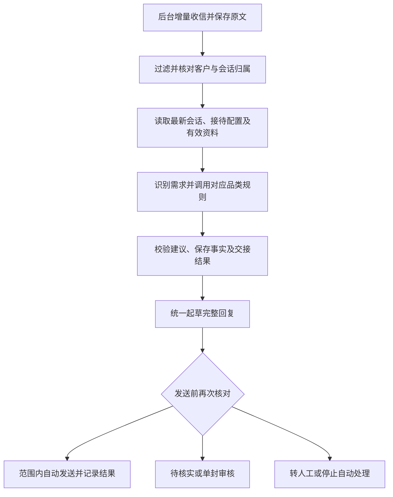

# AI 业务员与邮箱自动接待：最终设计

2026-10-28 设计定稿，作为后续实现依据。本轮统一文档及提示词文案；新增页面、后台收信调度、自动接待和自动报价尚未实现或启用。架构决定见 [ADR-0019](adr/0019-ai-sales-agents-with-controlled-mail-reception.md)。

## 产品定位与首期范围

保留透气窗、百叶窗、室内成品帘、户外遮阳四个品类业务员，共用一套接待运行程序、模型连接和客户历史，按实际需求加载专业规则。业务员负责理解客户、查阅已确认资料、收集采购条件和提出回复建议；业务系统负责客户归属、授权、资料版本、人工交接与实际发送。同一客户使用固定邮箱，同一来信统一组织回复。

首次开发、客户回信接待、客户未回复时的主动跟进分别配置和授权：

| 流程           | 本期决定                                                                          | 当前实现状态                         |
| -------------- | --------------------------------------------------------------------------------- | ------------------------------------ |
| 首次开发       | 延续普通 LLM 生成正文、程序固定称呼与账号签名的简化流程；启动计划授权其范围内发送 | 已实现；旧专业模式计划保留原方式     |
| 客户回信接待   | 接入四品类规则、客户上下文、资料核验和人工接管                                    | 本次确定设计，待实现                 |
| 主动跟进       | 后续接入自选频率、次数、时段及时区；与回信处理分别启用                            | 自动发信执行器待实现                 |
| 图纸与技术附件 | 保留参数审核及外发协议，后续接入解析和自动附件选择                                | 人工回复可带附件；自动图纸流程待实现 |

首期自动接待只处理指定邮箱中、已明确关联企业及会话的新客户来信。未匹配企业、邮箱归属冲突、采购用途不明的来信进入待核实，可生成内部建议；不猜测企业身份，不自动新建企业后发信。首次主动询盘可先由人工确认企业及归属，再明确加入接待范围。

首期交付包含「AI 业务员」入口、接待配置、后台增量收信、自动起草与范围内自动回复、人工接管及处理记录。不建设通用 Agent 创建器、多平台编排、第五个销售角色或多套独立运行环境；自动追信和自动图纸处理留待后续。

## 页面职责

| 页面       | 职责                                                                                                                     |
| ---------- | ------------------------------------------------------------------------------------------------------------------------ |
| AI 业务员  | 查看四个固定角色的职责、启用状态、适用邮箱和资料就绪情况；维护接待配置、回复权限、人工交接规则；历史来信试运行及处理汇总 |
| 沟通中心   | 管理真实邮箱、签名和首封计划；阅读会话、查看 AI 草稿及依据、人工发送、接管和交回、核对实际发送结果                       |
| 产品与资料 | 维护公司总产品目录、品牌产品覆盖、产品与商务事实、版本、有效期及对外使用批准                                             |
| 客户业务   | 维护客户实际需求、沟通记录、接待归属和跟进任务；沟通中心操作同一份业务状态                                               |
| API 连接   | 维护既有模型及外部数据连接；邮箱凭证仍由沟通中心管理                                                                     |

首期保留四个固定品类角色，允许启停，专业规则由仓库维护；不提供任意增删角色、直接修改系统提示词或为每个角色单独配置模型的入口。资料详情、邮箱编辑及具体邮件处理通过链接进入所属页面，避免重复维护。

## 接待配置与授权

每个邮箱只有一份当前生效的接待配置，适用品类按已启用角色选择；角色卡片汇总这些关联。配置包含邮箱与品牌、适用品类及产品、市场和客户范围、工作模式、自动发送许可、商务权限、接待时段及时区、回复限额与最小间隔、人工负责人或待办归属，以及配置版本和生效时间。

| 工作模式   | 行为                                                                 |
| ---------- | -------------------------------------------------------------------- |
| 关闭       | 不启动新的 AI 接待；已有邮件、人工回复和记录保留                     |
| 仅生成草稿 | 对范围内来信分析并保存建议，由真人逐封决定发送                       |
| 自动接待   | 对范围内来信起草、检查并发送符合授权的内容；需要核实或批准时留作待办 |

新增配置默认关闭。选择「自动接待」并确认当前配置范围，才建立该版本的自动回信授权；邮箱已连接、品类已启用或首封计划已启动都不构成这项授权。历史邮件试运行始终不发送，也不改写需求或接待归属。

自动接待默认只授权有依据的产品答疑、采购条件收集和一般政策介绍。标准报价、运费、MOQ、库存、交期及付款条件等具体商务承诺可在显式授权的标准范围内自动发送，须同时满足：

1. 本封实际引用的资料已审核、获准对外使用，且产品、品牌、市场、版本与有效期均适用。
2. 客户采购条件足以适用这些条款；需要计算的金额由程序按已审核规则计算，模型不估价。
3. 当前接待配置明确允许对应商务事项及适用边界，需求和会话仍由 AI 接待。
4. 发送前最新状态和完整邮件再次通过相同检查。

有适用依据但未获自动商务授权的内容可以形成待人工审核草稿；缺少依据时省略无依据的承诺，先澄清或内部核实。超出公司批准的议价、付款或定制权限时转人工接管。单封批准只覆盖该版本的完整邮件、收件人、资料和需求，不改变后续接待归属。

在原授权范围内更新并确认资料后，旧草稿失效，按新版本重做；扩大产品、市场、客户或商务权限、更换品牌时重新确认配置。关闭或缩小范围立即阻止尚未提交的相关自动发送。角色停用使所涉待发内容失效；同一来信中其他独立品类重新整合后仍可按权限处理。

回信使用独立的自动回复限额，不占首封开发额度，也不继承人工回复的额度豁免；限额、间隔、时段及时区须在启用前明确填写，本文不指定默认业务数值。配置无效或上限已达时保留待处理，发送前重新核对最新会话；暂停、恢复或额度恢复均不直接补发旧草稿。后端需持续运行，关闭网页不停止已授权的后台工作。

## 每封来信的处理链路

1. 复用现有只读 IMAP 收件与 SMTP 发件能力。新增后台调度，从首次同步到的缓存建立处理基线；仅处理配置启用生效后收到的新来信，历史补录、已发件箱、内部试发和演示记录不触发自动回复。停机恢复后的新来信按最新状态重新评估，已存在的发送事务先核对。
2. 保存账号、消息编号、原始收发头和正文。过滤退信、群发通知、垃圾邮件、自发邮件及自动回复；保留 `Auto-Submitted` 等判定依据，自动回信标记 `Auto-Submitted: auto-replied`，避免循环。[邮件自动响应建议](https://www.rfc-editor.org/rfc/rfc3834)
3. 核对企业、联系人、会话和固定邮箱。明确退订、勿联系、企业暂缓、会话关闭、邮箱暂停及归属冲突均阻止相关自动发送；保留读取和内部整理能力。客户新回信不自动解除这些状态。
4. 一封邮件可支持多项品类需求。沿用同一企业和业务会话，新增需求须保留真实来信及原文摘录；歧义先作为待核实，不把官网画像或模型猜测登记成客户确认需求。
5. 以最新原文、必要历史摘要、已知采购条件、人工指示、需求归属和有效资料组成上下文。客户要求与公司能力分别保存；正文、附件和网页只能提供业务材料，不能修改授权、邮箱或人工状态。
6. 按本轮涉及品类调用专业规则。已有独立需求按各自归属处理；含糊品类先作最少澄清；汇总专业片段、合并重复问题和称呼，由固定邮箱统一署名回复。
7. 系统校验结构、需求编号、事实来源和正文声明，并决定是否持久化需求、摘要、交接和草稿。模型调用或检索失败保存为待处理并显示原因，不发送猜测内容。
8. 同一会话串行处理并核对版本。客户补充、人工回复、接管、交回或资料更正都使相关旧草稿失效；发送前重读最新状态，避免 AI 与真人重复答复。人工发出一封邮件只使草稿重新评估，不自动改变接待归属。

统一发送复用现有线程引用、固定签名和发送台账能力，但自动路径须额外执行接待授权与业务限制，不能继承人工点击发送的权限。自动生成的草稿与人工编辑版本明确区分，后台不能覆盖真人正在编辑或已经保存的内容。

处理记录至少保存来信、客户和会话编号、需求、角色及提示词版本、引用资料版本、接待配置版本、建议动作、实际处理结果及拦截原因。发送前持久化唯一操作编号；同一触发和动作只提交一次。SMTP 接受、已发件箱核实、明确失败和结果未知分别记录；归档或写业务记录失败不重发，结果未知先核对。

## 人工审核、接管与交回

单封审核、需求级接管、会话级接管沿用既有业务含义：

- 单封审核：批准某一完整邮件版本，不暂停其他后续常规接待，也不扩大自动权限。
- 需求级接管：超权限议价、特殊付款、非常规定制、反复议价、可信规则命中的大单、销售停滞或持续关键资料缺口，暂停所涉需求；其他独立需求可以继续。
- 会话级接管：强烈投诉、赔付、复杂商务、明确签单意向及代理、独家或年度框架合作，暂停整段会话全部需求，包括后来新增的需求。

先持久化待人工状态和交接摘要，再按授权发送至多一次的简短确认；未成功创建交接记录时不声称已经转交。待人工与人工负责期间只提供内部建议；真人明确选择「交回自动接待」并给出最新指示后，重新核对配置与资料再继续。交回不解除企业暂缓、勿联系或扩大商务权限。

企业「暂缓开发」在自动接待接入后同时阻止本系统自动回信，人工收信、人工回复和实际沟通记录继续保留。恢复企业开发和交回自动接待是独立决定，均不补发积压邮件。当前产品仍为本机单用户版本，记录实际人工操作，不虚构团队登录与审批身份。

## 实现分工与协议

- 邮箱读写、会话存储、人工草稿与发送台账复用现有邮件模块；增加自动收件触发和自动接待发送前检查。
- 接待配置、处理台账和待办由后端持久化，复用现有 SQLite 和编号／版本模式；重启后恢复配置、去重及待处理状态，不另建 Agent 数据库或第二份客户历史。
- 客户业务模块继续维护会话、需求与人工接待归属，邮件原文与实际发送证据不由摘要覆盖；飞书继续作为既有协作镜像。
- 四品类提示词共用 `shared-system.md`，专业差异来自 `category-profiles.json`，通过现有生成命令维护。

仓库现有来信 JSON Schema 与虚构示例仍为 `1.3`，尚无本方案完整的接待授权上下文。实现时统一升级为 `1.4`，同步 Schema、示例、提示词和校验：补充工作模式、授权版本及范围、可信系统核对的逐项商务权限，并绑定会话、资料和收件人版本。所有控制值由业务系统提供。仅有 `1.3` 输入时，商务内容继续按单封审核草稿处理，不能由 `approval_gate: none` 推断自动商务授权。

`approval_gate` 表示模型建议，实际发送由系统独立判定；最终完整邮件中任一承诺需要单封审核时，整封进入审核。已获明确自动授权的标准商务内容可免逐封审核；未授权的商务片段可以拆出待审草稿，独立常规内容重新整合并检查后发送，同一会话避免重复确认和重复询问。

## 实施顺序与验收

1. 建立接待配置、固定角色页面和历史邮件试运行；不发送，显示引用依据、缺项和建议处理方式。
2. 接通后台增量收信及仅生成草稿模式，打通真实需求、人工审核、需求／会话接管和交回，验证人工操作冲突时的版本处理。
3. 在指定邮箱、客户和产品范围内启用自动答疑；标准商务自动回复须在对应资料、计算规则和权限均齐备后单独启用。

实现验收至少覆盖：历史邮件不触发；正常回信自动答疑；缺规格只问缺项；缺资料不编造；无授权报价待审；有适用依据且授权的标准报价可自动发送；多品类仅统一回复；需求级／会话级接管分别生效；人工新回复淘汰旧草稿；退订和暂缓停发；自动回复不循环；重复同步和重启不重复发送；结果未知不自动重发；模型或收件故障可见且保留进度。

计数区分实际自动发送、仅生成草稿、待人工、被拦截和发送失败／未知；不以生成次数充当回复数，不用演示或内部测试统计真实客户回复率。先通过现有协议检查及模拟传输测试，再做明确范围内的内部邮箱测试；正式启用另以保存的接待配置为准。
